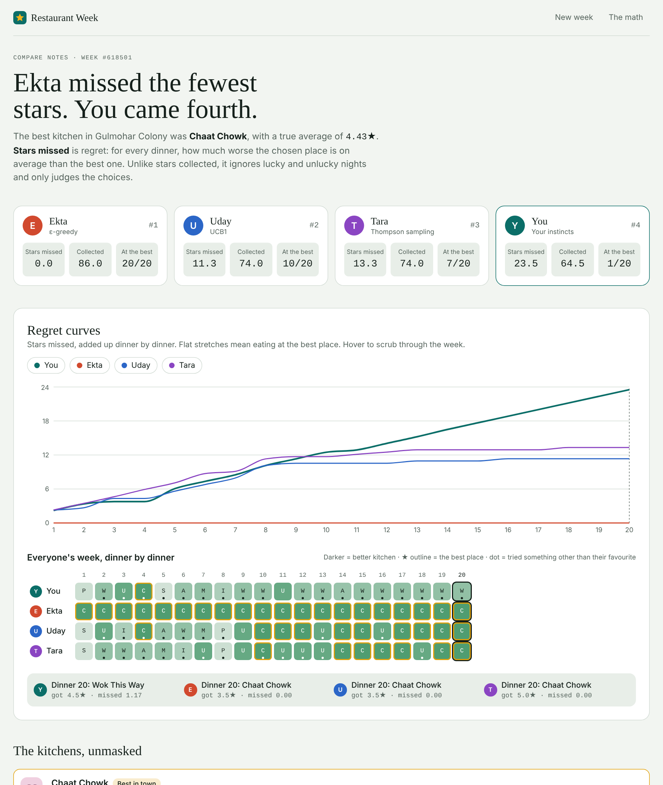

# Restaurant Week

**A small game about exploration vs. exploitation, backed by a tested implementation of ε-greedy, UCB1 and Thompson sampling.**

You've just moved to a new neighbourhood with 8 restaurants and 20 dinners to find the best one. Every meal's rating is a bit random. Three friends play the same week with the same luck, each using a classic multi-armed bandit algorithm. At the end you compare everyone's **regret curves** and see who wasted the fewest evenings.

[](https://github.com/ashwinruke/restaurant-week/actions/workflows/ci.yml)

**Play it:** https://ashwinruke.github.io/restaurant-week/



## What's inside

| Part | What it is |
|---|---|
| [`game/`](game) | React + TypeScript game. Play a week, then compare regret curves, a dinner-by-dinner timeline and the true kitchen qualities. A "See the math" lab averages the three strategies over up to 1,000 neighbourhoods and 2,000 dinners. |
| [`bandits/`](bandits) | Python package with the same three agents, Bernoulli / Gaussian / star-rating environments, an experiment runner, the Lai–Robbins bound, a CLI and a pytest suite that checks the behaviour theory predicts. |
| [`bandits/notebooks/regret_analysis.ipynb`](bandits/notebooks/regret_analysis.ipynb) | The analysis: regret curves, log-scale view, the Lai–Robbins lower bound, ε and c sweeps, and why short horizons blur the differences. The game's **Notebook** page renders it, and **Run it in your browser** opens it in JupyterLite (Python in the browser via Pyodide, nothing to install). |
| [`scripts/build_lab.py`](scripts/build_lab.py) | Builds the runnable JupyterLite copy of the notebook into `game/dist/lab`; the Pages deploy runs it automatically. |

## The three friends

| Friend | Algorithm | Rule | Regret growth |
|---|---|---|---|
| **Ekta** | ε-greedy | with probability ε pick a random place, otherwise the best average `argmax Q̂ₐ` | linear (constant ε) |
| **Uday** | UCB1 | `argmax Q̂ₐ + c·√(ln t / nₐ)`, optimism in the face of uncertainty | logarithmic |
| **Tara** | Thompson sampling | draw `θₐ` from each place's posterior, go to `argmax θₐ` | logarithmic, matches the Lai–Robbins bound on Bernoulli arms |

## Results

Average over 150 fresh 8-restaurant neighbourhoods, 1,000 dinners each (from the notebook):

| Strategy | Stars missed (regret) at T = 1,000 | At the best place, last 10% |
|---|---|---|
| ε-greedy (ε = 0.1) | 233.3 ± 117.9 | 86.5% |
| UCB1 (c = 0.3) | 66.0 ± 13.7 | 97.0% |
| Thompson sampling | **45.1 ± 15.2** | **98.8%** |

In a single 20-dinner week the three are much closer and the spread is wide, which is exactly why a human can beat them in one game but not over a thousand.

## Design decisions

- **Regret, not reward.** Scores use pseudo-regret, Σ (μ* − μ of the chosen arm). It judges decisions and ignores lucky or unlucky meals.
- **Common random numbers.** Every restaurant has its own seeded stream of ratings, so your 3rd visit to a place gets the same rating as anyone's 3rd visit. Differences between players come from choices, not dice. Every week is replayable from its seed.
- **One scale for learning.** Star ratings are mapped to [0, 1] as (stars − 1) / 4 before the agents see them.
- **UCB1's constant.** The textbook c = √2 assumes rewards spread over all of [0, 1]. Meal ratings vary about ±0.2 on that scale (σ = 0.8 stars), so the game uses c ≈ σ√2 ≈ 0.3. The notebook shows the sweep.
- **Thompson prior.** Normal prior N(0.5, 0.25²) with known noise σ = 0.2 on the unit scale, giving a closed-form Normal posterior.

## Run it locally

**Game** (Node 20+):

```bash
cd game
npm install
npm run dev        # http://localhost:5173
npm test           # Vitest
npm run build      # production build in game/dist
```

**Runnable notebook** (optional locally; GitHub Pages builds it for you):

```bash
pip install -r scripts/requirements-lab.txt   # from the repo root
cd game && npm run build && cd ..
python scripts/build_lab.py                   # JupyterLite into game/dist/lab
cd game && npm run preview                    # "Run it in your browser" now works locally
```

**Python package** (Python 3.10+):

```bash
cd bandits
python -m venv .venv && source .venv/bin/activate   # Windows: .venv\Scripts\activate
pip install -e ".[dev,notebook]"
pytest
python -m bandits --horizon 1000 --runs 200 --plot regret.png
jupyter notebook notebooks/regret_analysis.ipynb
```

## Project layout

```
restaurant-week/
├── game/
│   ├── src/bandits/     # TypeScript agents, seeded RNG, kitchens, simulation
│   ├── src/screens/     # Intro, Play, Reveal (regret curves), Lab (the math)
│   ├── src/store/       # Zustand game state
│   └── tests/           # Vitest
├── bandits/
│   ├── bandits/         # envs.py, agents.py, simulate.py, CLI
│   ├── tests/           # pytest
│   └── notebooks/
└── .github/workflows/   # CI + GitHub Pages deploy
```

## Further reading

- Sutton & Barto, *Reinforcement Learning: An Introduction*, chapter 2 (free online).
- Lattimore & Szepesvári, *Bandit Algorithms* (free online).
- Russo et al., *A Tutorial on Thompson Sampling*.
- Auer, Cesa-Bianchi & Fischer (2002), *Finite-time Analysis of the Multiarmed Bandit Problem* (UCB1).

## License

MIT
